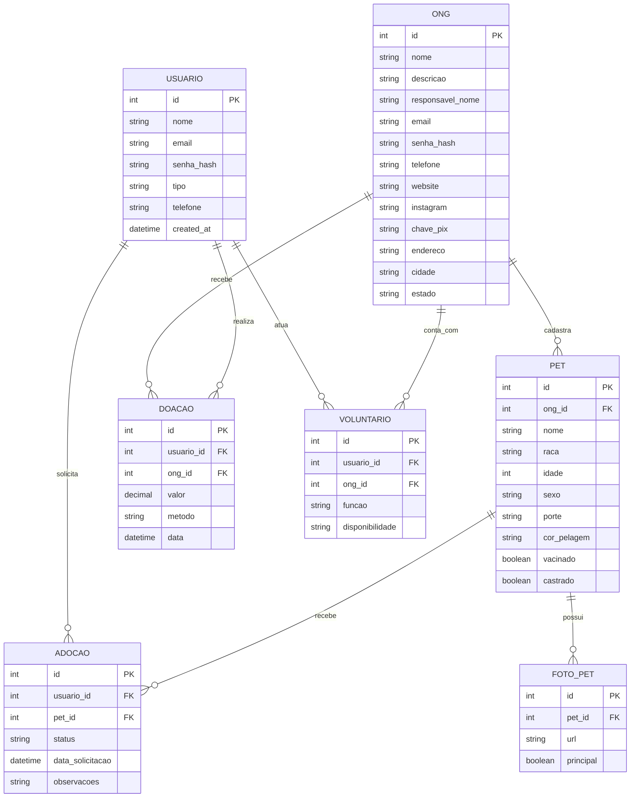

<div align="center">

**EE PROFESSOR ROLDÃO LOPES DE BARROS**

Habilitação profissional: Técnico em Desenvolvimento de Sistemas

<br>

**EDUARDO SOUZA**
**THAYLON**
**TAMIRES**
**MATHEUS DIAS**
**DIEGO**

<br><br>

# ELOPETS

**Plataforma web para ONGs de proteção animal**

<br><br>

São Paulo
2026

</div>

---

<div align="center">

# ELOPETS

**Plataforma web para ONGs de proteção animal**

</div>

> Trabalho de Conclusão de Curso apresentado à EE Professor Roldão Lopes de Barros como requisito parcial para a obtenção do título de Técnico em Desenvolvimento de Sistemas.
>
> **Orientadores:** Prof. Josef e Profª Juliette

<div align="center">

São Paulo
2026

</div>

---

## RESUMO

O EloPets é uma plataforma web que conecta organizações não governamentais (ONGs) de proteção animal, adotantes, doadores e voluntários. O projeto parte da observação de que muitas ONGs enfrentam falta de recursos (alimentos, medicamentos e apoio financeiro) e de voluntários, enquanto há pessoas dispostas a ajudar que não sabem como ou onde contribuir. A plataforma centraliza a divulgação de animais para adoção, o cadastro e a gestão de ONGs parceiras, o recebimento de doações, a candidatura a ações de voluntariado e a conscientização sobre a posse responsável. O sistema é desenvolvido em Java, com banco de dados MySQL e interface responsiva.

**Palavras-chave:** adoção animal; ONGs; doações; voluntariado; plataforma web.

---

## SUMÁRIO

1. [Introdução](#1-introdução)
   - 1.1 [Justificativa](#11-justificativa)
   - 1.2 [Objetivos](#12-objetivos)
2. [Equipe e instituição](#2-equipe-e-instituição)
3. [Tecnologias e características técnicas](#3-tecnologias-e-características-técnicas)
4. [Requisitos do sistema](#4-requisitos-do-sistema)
   - 4.1 [Requisitos funcionais](#41-requisitos-funcionais)
   - 4.2 [Requisitos não funcionais](#42-requisitos-não-funcionais)
   - 4.3 [Funcionalidades futuras](#43-funcionalidades-futuras)
5. [Modelagem](#5-modelagem)
   - 5.1 [Mapa do site](#51-mapa-do-site)
   - 5.2 [Diagrama entidade-relacionamento](#52-diagrama-entidade-relacionamento)
   - 5.3 [Dicionário de dados](#53-dicionário-de-dados)
6. [Proteção de dados pessoais](#6-proteção-de-dados-pessoais)
7. [Instalação e execução](#7-instalação-e-execução)
8. [Considerações finais](#8-considerações-finais)
9. [Referências](#referências)

---

## 1 INTRODUÇÃO

O EloPets é o Trabalho de Conclusão de Curso (TCC) do Curso Técnico em Desenvolvimento de Sistemas da EE Professor Roldão Lopes de Barros. O projeto utiliza a tecnologia como ferramenta de apoio social, criando uma ponte digital entre ONGs de proteção animal, adotantes e doadores.

A plataforma centraliza:

- a divulgação de animais disponíveis para adoção;
- o cadastro e a gestão de ONGs parceiras;
- o recebimento de doações e o voluntariado;
- a conscientização sobre a posse responsável.

### 1.1 Justificativa

Muitas ONGs de proteção animal enfrentam dificuldades relacionadas à falta de recursos, como alimentos, medicamentos e apoio financeiro, além da escassez de voluntários. Ao mesmo tempo, existem pessoas e instituições dispostas a ajudar, mas que não sabem como ou onde contribuir. A plataforma facilita essa conexão, promovendo colaboração, solidariedade e melhor distribuição de recursos entre as ONGs mais necessitadas.

### 1.2 Objetivos

**Objetivo geral:** desenvolver uma plataforma web que conecte ONGs de proteção animal entre si e com pessoas interessadas em ajudar, facilitando a troca de recursos, doações e apoio voluntário.

**Objetivos específicos:**

- permitir o cadastro e a gestão de usuários e ONGs;
- divulgar animais para adoção com filtros de busca;
- permitir solicitações de adoção e o acompanhamento do status;
- registrar doações e candidaturas a voluntariado;
- oferecer uma interface responsiva, intuitiva e segura.

---

## 2 EQUIPE E INSTITUIÇÃO

| Papel | Nome |
Autor: Eduardo Souza
Autor: Thaylon
Autora: Tamires
Autor: Matheus Dias
Autor: Diego
Orientador: Prof. Josef
Orientadora: Profª Juliette

**Instituição:** EE Professor Roldão Lopes de Barros, São Paulo, 2026.

---

## 3 TECNOLOGIAS E CARACTERÍSTICAS TÉCNICAS

| Item | Descrição |
Linguagem: Java 
Banco de dados: MySQL
Aplicação: Plataforma web
Interface: Responsiva (dispositivos móveis e desktop)
Segurança: Proteção dos dados dos usuários
Desempenho: Tempo de resposta adequado
Design: Intuitivo e de fácil usabilidade

---

## 4 REQUISITOS DO SISTEMA

### 4.1 Requisitos funcionais

| Código | Descrição |
RF01: O administrador deve cadastrar e gerenciar usuários e ONGs.
RF02: O usuário deve realizar cadastro na plataforma. 
RF03: O usuário pode informar suas áreas de interesse (doação, adoção etc.).
RF04: O usuário pode buscar ONGs por localização, tipo de causa ou necessidade.
RF05: O usuário pode visualizar informações detalhadas das ONGs.
RF06: O usuário pode se candidatar a ações de voluntariado.
RF07: O usuário pode realizar doações para ONGs cadastradas.
RF08: A ONG deve cadastrar seus projetos, campanhas e necessidades.
RF09: A ONG deve atualizar informações sobre suas atividades.

### 4.2 Requisitos não funcionais

| Código | Descrição |
RNF01: Interface responsiva, adaptável a dispositivos móveis e desktop.
RNF02: Segurança dos dados dos usuários (senhas armazenadas com *hash*).
RNF03: Bom desempenho e tempo de resposta adequado.
RNF04: Design intuitivo e de fácil usabilidade.

### 4.3 Funcionalidades futuras

- Chat em tempo real entre usuários e ONGs;
- doações via PIX / PagSeguro;
- geolocalização de ONGs próximas;
- aplicativo móvel;
- gamificação para voluntários;
- relatórios e *dashboards* analíticos.

---

## 5 MODELAGEM

### 5.1 Mapa do site

```text
EloPets
├── / (Home)
│   ├── Destaques de pets
│   └── Campanhas ativas
├── /pets
│   ├── /pets/:id (Detalhes)
│   └── /pets/filtros (Espécie, Porte, Idade, Cidade)
├── /ongs
│   ├── /ongs/:id (Perfil da ONG)
│   └── /ongs/cadastro
├── /adocao
│   ├── /adocao/solicitar/:petId
│   └── /adocao/status
├── /doacoes
│   ├── /doacoes/pix
│   └── /doacoes/historico
├── /voluntariado
├── /sobre
│   ├── /sobre/contato
│   └── /sobre/faq
├── /auth
│   ├── /login
│   └── /registro
└── /admin (ONG/Admin)
    ├── /admin/dashboard
    ├── /admin/pets
    ├── /admin/adocoes
    └── /admin/usuarios
```

### 5.2 Diagrama entidade-relacionamento



**Relacionamentos principais**

- **USUARIO – ADOCAO:** um usuário faz várias solicitações.
- **PET – ADOCAO:** um pet pode ter várias solicitações (apenas uma aprovada).
- **ONG – PET:** uma ONG cadastra vários pets.
- **ONG – DOACAO:** uma ONG recebe várias doações.
- **PET – FOTO_PET:** cada pet possui várias fotos.
- **USUARIO – ONG (via VOLUNTARIO):** usuários atuam como voluntários em ONGs.

### 5.3 Dicionário de dados

Os tipos abaixo são uma sugestão para o MySQL e podem ser ajustados.

**USUARIO**

| Campo | Tipo sugerido | Observação |
| id | INT, PK, auto incremento | |
| nome | VARCHAR(120) | |
| email | VARCHAR(160), único | |
| senha_hash | VARCHAR(255) | nunca armazenar a senha em texto puro |
| tipo | ENUM | ex.: adotante, doador, voluntário, admin |
| telefone | VARCHAR(20) | opcional |
| created_at | DATETIME | |

**ONG**

| Campo | Tipo sugerido | Observação |
| id | INT, PK | |
| nome, descricao | VARCHAR / TEXT | informações básicas |
| responsavel_nome, email, senha_hash | VARCHAR | credenciais de acesso; "confirmar senha" é apenas um campo do formulário |
| telefone, website, instagram, chave_pix | VARCHAR | contato |
| endereco, cidade, estado | VARCHAR | localização |

**PET**

| Campo | Tipo sugerido | Observação |
| id | INT, PK | |
| ong_id | INT, FK → ONG | no rascunho original constava `post_id`; confirme se o correto é `ong_id` |
| nome, raca, cor_pelagem | VARCHAR | |
| idade | INT | |
| sexo, porte | ENUM | |
| vacinado, castrado | BOOLEAN | |


**ADOCAO, DOACAO, FOTO_PET e VOLUNTARIO:** conforme o diagrama da seção 5.2. Em ADOCAO, `status` pode assumir valores como *pendente*, *em análise*, *aprovada* e *recusada*.

---

## 6 PROTEÇÃO DE DADOS PESSOAIS

O sistema trata dados pessoais e, por isso, deve observar a Lei Geral de Proteção de Dados (BRASIL, 2018). Recomenda-se:

- coletar apenas os dados necessários à finalidade (princípio da necessidade);
- armazenar senhas somente com *hash* e comunicar-se por HTTPS;
- informar ao titular a finalidade do tratamento e oferecer meios de acessar, corrigir e excluir seus dados;
- manter política de privacidade e termos de uso acessíveis na plataforma.

---

## 7 INSTALAÇÃO E EXECUÇÃO

```bash
git clone (https://github.com/thaylonkkjjk/elopetss/tree/main/ONG-ELOPETS)
cd elopets
```

---

## 8 CONSIDERAÇÕES FINAIS

O EloPets propõe uma solução tecnológica de apoio social, aproximando ONGs de proteção animal de pessoas dispostas a adotar, doar e voluntariar-se. Em relação aos objetivos propostos, foram desenvolvidas as funcionalidades de cadastro de usuários e ONGs, divulgação de animais para adoção com filtros, solicitação de adoção, registro de doações e candidatura ao voluntariado.
A plataforma foi construída em Java, com banco de dados MySQL e interface responsiva, buscando segurança dos dados, bom desempenho e facilidade de uso.
Durante o desenvolvimento, a equipe encontrou dificuldades como integração entre o sistema e o banco, organização do trabalho em grupo e prazos. Essas dificuldades contribuíram para a formação técnica dos integrantes, que aplicaram na prática conhecimentos adquiridos ao longo do curso, como programação e versionamento com Git.
Como limitações, como: a ausência de pagamentos reais e a falta de testes com ONGs reais.
Como trabalhos futuros, sugere-se a implementação de chat em tempo real entre usuários e ONGs, doações via PIX e PagSeguro, geolocalização de ONGs próximas, e aplicativo móvel. Recomenda-se ainda validar a plataforma com ONGs parceiras, para ajustá-la às necessidades reais de quem atua na proteção animal.
Conclui-se que o EloPets cumpre o objetivo de servir como ponte digital entre ONGs, adotantes, doadores e voluntários, e que tem potencial para ser ampliado e utilizado como ferramenta de impacto social.

---

## REFERÊNCIAS

BRASIL. **Lei nº 13.709, de 14 de agosto de 2018.** Lei Geral de Proteção de Dados Pessoais (LGPD). Brasília, DF: Presidência da República, 2018.
